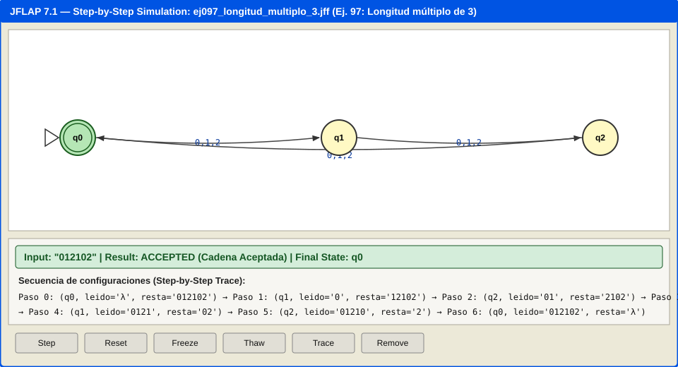
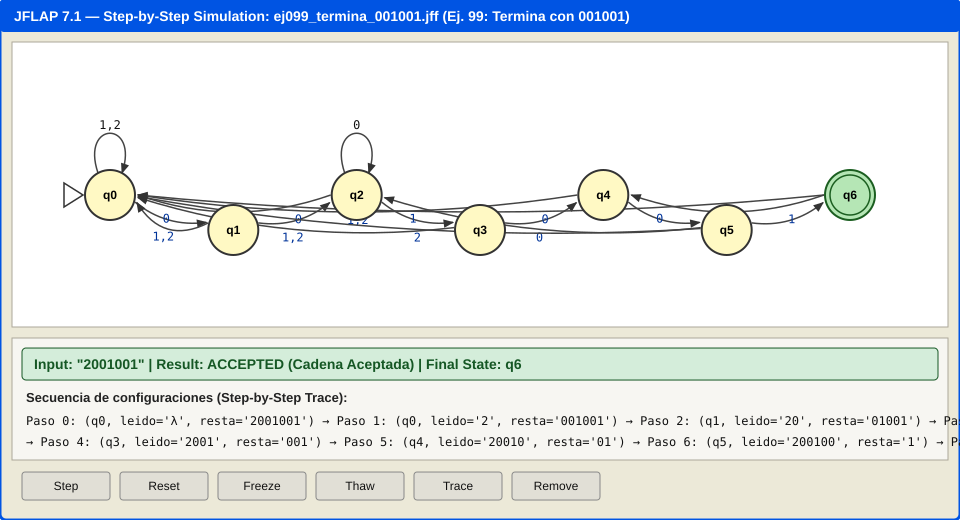
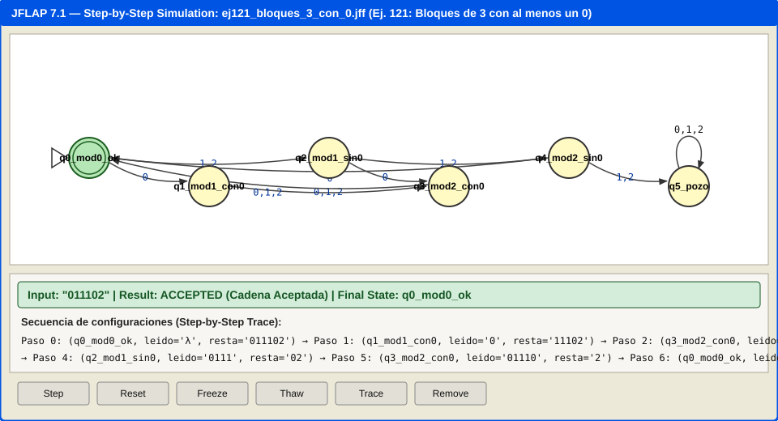
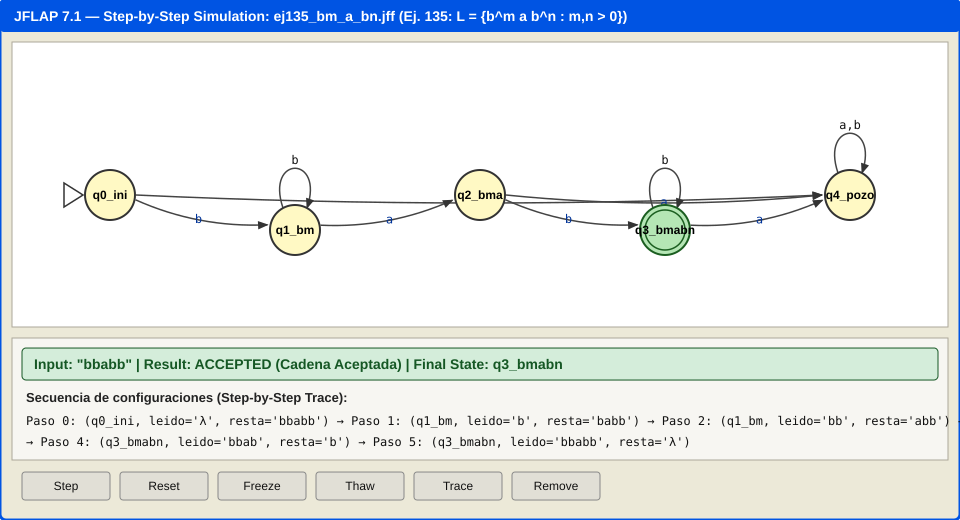
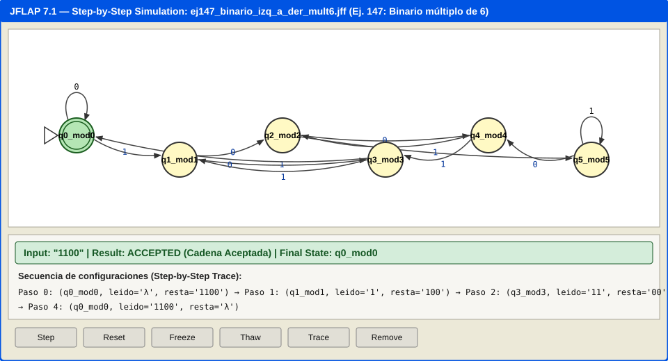
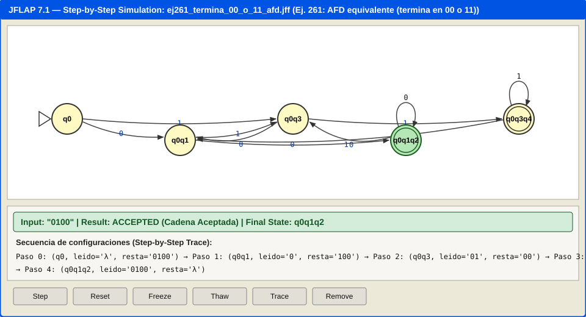

# Ejercicio 4. Autómatas finitos en JFLAP

En este documento se presenta la resolución completa, justificación formal del diseño (indicando qué invariante o información del prefijo leído representa cada estado), tablas de transiciones, validación con casos de prueba (al menos tres cadenas válidas, tres inválidas y caso frontera) y simulaciones paso a paso en **JFLAP** de todos los ejercicios marcados con asterisco (`*`) de la **Lista 2** (ejercicios 94 a 150) y de la **Lista 3** (ejercicios 151 a 263).

Todos los archivos `.jff` exportados se encuentran versionados dentro de la carpeta [`automatas/`](../automatas/).

---

## Parte 1. Lista 2 — Autómatas Finitos Deterministas (Ejercicios 94 a 150 con `*`)

Los alfabetos definidos en la Lista 2 son:
* $\Sigma_1 = \{0, 1, 2\}$
* $\Sigma_2 = \{a, b, c, 0, 1\}$
* $\Sigma_3 = \{a, b\}$

---

### Ejercicio 97* — Palabras de $\Sigma_1$ cuya longitud es un múltiplo de 3
* **Archivo JFLAP**: [`automatas/ej097_longitud_multiplo_3.jff`](../automatas/ej097_longitud_multiplo_3.jff)
* **Proceso de diseño y significado de cada estado (invariante del prefijo $u$ leído)**:
  Para decidir si $|w| \equiv 0 \pmod 3$, el autómata únicamente necesita recordar el residuo módulo $3$ de la longitud del prefijo leído $u$:
  * $q_0$ (inicial y de aceptación): $|u| \equiv 0 \pmod 3$ (incluye la cadena vacía $\lambda$, pues $|\lambda| = 0 = 3 \times 0$).
  * $q_1$: $|u| \equiv 1 \pmod 3$.
  * $q_2$: $|u| \equiv 2 \pmod 3$.
* **Tabla de transiciones (Tabla 1 de 10)**:

| Estado actual | `0` | `1` | `2` | Significado del prefijo $u$ |
| :--- | :---: | :---: | :---: | :--- |
| $\to *q_0$ | $q_1$ | $q_1$ | $q_1$ | $|u| \bmod 3 = 0$ |
| $q_1$ | $q_2$ | $q_2$ | $q_2$ | $|u| \bmod 3 = 1$ |
| $q_2$ | $q_0$ | $q_0$ | $q_0$ | $|u| \bmod 3 = 2$ |

* **Validación y pruebas**:
  * **Cadenas válidas (Aceptadas)**:
    1. `λ` (Caso frontera, longitud $0$): Termina en $q_0 \in F$.
    2. `012` (longitud $3$): $q_0 \xrightarrow{0} q_1 \xrightarrow{1} q_2 \xrightarrow{2} q_0 \in F$.
    3. `012102` (longitud $6$): Termina en $q_0 \in F$.
  * **Cadenas inválidas (Rechazadas)**:
    1. `0` (Caso frontera inferior, longitud $1$): Termina en $q_1 \notin F$.
    2. `12` (Caso frontera umbral, longitud $2$): Termina en $q_2 \notin F$.
    3. `0120` (longitud $4$): Termina en $q_1 \notin F$.
* **Simulación paso a paso en JFLAP (Simulación 1 de 6)**:
  

---

### Ejercicio 99* — Palabras de $\Sigma_1$ que terminan con la cadena `001001`
* **Archivo JFLAP**: [`automatas/ej099_termina_001001.jff`](../automatas/ej099_termina_001001.jff)
* **Proceso de diseño y significado de cada estado**:
  Se aplica la construcción del autómata de emparejamiento de cadenas (función de prefijo KMP) para el patrón $P = \text{001001}$ de longitud $6$. Cada estado $q_k$ ($0 \le k \le 6$) representa que el **sufijo más largo del prefijo leído $u$ que coincide con un prefijo de `001001` tiene longitud exactamente $k$**:
  * $q_0$ (inicial): Ningún sufijo no vacío coincide con prefijo de `001001` ($\lambda$).
  * $q_1$: El prefijo leído termina en `0`.
  * $q_2$: El prefijo leído termina en `00`.
  * $q_3$: El prefijo leído termina en `001`.
  * $q_4$: El prefijo leído termina en `0010`.
  * $q_5$: El prefijo leído termina en `00100`.
  * $q_6$ (único estado de aceptación): El prefijo leído termina exactamente en `001001`. Si llega otro símbolo después, el autómata retrocede al borde correspondiente ($q_1$ con `0`, $q_0$ con `1` o `2`) porque la condición exige que la palabra *termine* en `001001`.
* **Tabla de transiciones (Tabla 2 de 10)**:

| Estado | `0` | `1` | `2` | Prefijo de `001001` reconocido al final de $u$ |
| :--- | :---: | :---: | :---: | :--- |
| $\to q_0$ | $q_1$ | $q_0$ | $q_0$ | $\lambda$ (longitud 0) |
| $q_1$ | $q_2$ | $q_0$ | $q_0$ | `0` |
| $q_2$ | $q_2$ | $q_3$ | $q_0$ | `00` |
| $q_3$ | $q_4$ | $q_0$ | $q_0$ | `001` |
| $q_4$ | $q_5$ | $q_0$ | $q_0$ | `0010` |
| $q_5$ | $q_2$ | $q_6$ | $q_0$ | `00100` |
| $*q_6$ | $q_4$ | $q_0$ | $q_0$ | `001001` (Aceptación) |

* **Validación y pruebas**:
  * **Válidas**: `001001` (caso frontera: cadena aceptada más corta), `2001001`, `001001001` (con traslape de `001`).
  * **Inválidas**: `λ` (vacía, queda en $q_0$), `00100` (caso frontera a un símbolo de aceptar, queda en $q_5$), `0010012` (termina en `2`, regresa a $q_0$).
* **Simulación paso a paso en JFLAP (Simulación 2 de 6)**:
  

---

### Ejercicio 102* — Palabras de $\Sigma_3 = \{a, b\}$ que contienen la cadena `abbbab`
* **Archivo JFLAP**: [`automatas/ej102_contiene_abbbab.jff`](../automatas/ej102_contiene_abbbab.jff)
* **Significado de los estados**:
  * $q_0 \dots q_5$: Longitud del mayor prefijo de `abbbab` que es sufijo de la entrada leída hasta el momento ($\lambda$, `a`, `ab`, `abb`, `abbb`, `abbba`), sin haber completado aún `abbbab`.
  * $q_6$ (aceptación, estado absorbente): Ya se leyó al menos una vez la subcadena `abbbab` ($\delta(q_6, a) = q_6, \delta(q_6, b) = q_6$).
* **Pruebas**:
  * **Válidas**: `abbbab` (frontera mínima), `aaabbbabba`, `babbbab`.
  * **Inválidas**: `λ`, `abbba` (frontera de longitud 5), `abbbba`.

---

### Ejercicio 103* — Palabras de $\Sigma_3 = \{a, b\}$ que contienen la cadena `aabbba`
* **Archivo JFLAP**: [`automatas/ej103_contiene_aabbba.jff`](../automatas/ej103_contiene_aabbba.jff)
* **Significado de los estados**:
  * $q_0 \dots q_5$: Representan los prefijos parciales $\lambda$, `a`, `aa`, `aab`, `aabb`, `aabbb` (con bucle en $q_2$ al leer `a` adicional, pues `aaa` sigue terminando en `aa`).
  * $q_6$ (aceptación, absorbente): Se completó la subcadena `aabbba`.
* **Pruebas**:
  * **Válidas**: `aabbba` (frontera mínima), `aaabbba`, `baabbbab`.
  * **Inválidas**: `λ`, `aabbb` (frontera de longitud 5), `ababbba`.

---

### Ejercicio 106* — Palabras de $\Sigma_1$ que incluyen la subcadena `1101001`
* **Archivo JFLAP**: [`automatas/ej106_incluye_1101001.jff`](../automatas/ej106_incluye_1101001.jff)
* **Significado de los estados**:
  * $q_0 \dots q_6$: Prefijos acumulados $\lambda$, `1`, `11`, `110`, `1101`, `11010`, `110100`.
  * $q_7$ (aceptación, absorbente): El prefijo leído ya contiene `1101001`.
* **Pruebas**:
  * **Válidas**: `1101001` (frontera mínima), `0211010012`, `11101001`.
  * **Inválidas**: `λ`, `110100` (frontera de longitud 6), `1101021`.

---

### Ejercicio 107* — Palabras de $\Sigma_1$ que incluyen al menos una vez `0101` y al menos una vez `021`
* **Archivo JFLAP**: [`automatas/ej107_incluye_0101_y_021.jff`](../automatas/ej107_incluye_0101_y_021.jff)
* **Proceso de diseño y significado de los estados**:
  Se construye el autómata producto accesible cuyos estados codifican la cuádrupla $(t_1, t_2, l_1, l_2)$, donde $t_1 \in \{\text{F}, \text{V}\}$ indica si ya apareció `0101`, $t_2 \in \{\text{F}, \text{V}\}$ si ya apareció `021`, $l_1 \in \{0..3\}$ es el progreso actual hacia `0101` y $l_2 \in \{0..2\}$ el progreso hacia `021`. El estado de aceptación es aquel donde $t_1 = \text{V} \land t_2 = \text{V}$. Notamos que ambas subcadenas pueden traslaparse (por ejemplo, `0101` termina en `01` pero `021` empieza en `0`, así que `0101021` o `0210101` comparten un `0`).
* **Pruebas**:
  * **Válidas**: `0210101` (frontera mínima con traslape, longitud 6), `0101021`, `20101220210`.
  * **Inválidas**: `λ`, `0101` (solo tiene la primera), `021010` (frontera a un símbolo de completar ambas).

---

### Ejercicio 109* — Palabras de $\Sigma_2$ que incluyen `abbcb` y `cbaabb` (asumiendo que sí se pueden traslapar)
* **Archivo JFLAP**: [`automatas/ej109_incluye_abbcb_y_cbaabb.jff`](../automatas/ej109_incluye_abbcb_y_cbaabb.jff)
* **Significado de los estados**:
  Autómata producto $(t_1, t_2, l_1, l_2)$ que rastrea simultáneamente el progreso KMP hacia $P_1 = \text{abbcb}$ y $P_2 = \text{cbaabb}$. Como se permite traslape, en la cadena `abbcbaabb` el sufijo `cb` de `abbcb` actúa simultáneamente como los dos primeros símbolos de `cbaabb`.
* **Pruebas**:
  * **Válidas**: `abbcbaabb` (frontera mínima con traslape de `cb`, longitud 9), `cbaabbabbcb` (traslape de `abb`, longitud 11), `0abbcb1cbaabb`.
  * **Inválidas**: `λ`, `abbcb` (solo contiene la primera), `abbcbaab` (frontera de longitud 8, falta la última `b`).

---

### Ejercicio 111* — Palabras de $\Sigma_1$ que contienen exactamente tres veces la subcadena `01002`
* **Archivo JFLAP**: [`automatas/ej111_exactamente_tres_01002.jff`](../automatas/ej111_exactamente_tres_01002.jff)
* **Significado de los estados**:
  Como `01002` empieza en `0` y termina en `2`, dos ocurrencias de `01002` no tienen bordes no vacíos que se traslapen. Cada estado `q_cX_pY` codifica $(c, p)$, donde $c \in \{0, 1, 2, 3, 4\}$ es el número de veces que ha aparecido `01002` ($c=4$ representa "4 o más veces", estado trampa de rechazo) y $p \in \{0..4\}$ es la longitud del prefijo de `01002` activo actualmente. Los estados de aceptación son todos aquellos con $c = 3$.
* **Pruebas**:
  * **Válidas**: `010020100201002` (frontera mínima de longitud 15), `101002201002001002`, `01002010020100211`.
  * **Inválidas**: `λ`, `0100201002` (frontera inferior: solo 2 veces), `01002010020100201002` (frontera superior: 4 veces, rechazada por exceder 3).

---

### Ejercicio 112* — Palabras de $\Sigma_1$ que contienen dos veces `010` (sin traslape)
* **Archivo JFLAP**: [`automatas/ej112_dos_veces_010_sin_traslape.jff`](../automatas/ej112_dos_veces_010_sin_traslape.jff)
* **Significado de los estados**:
  Al completarse la primera ocurrencia de `010`, el contador de prefijo se reinicia a $p = 0$ (no se reutiliza el último `0` como inicio de la segunda ocurrencia). Por ello, `01010` queda en cuenta $1$ y prefijo `0` (rechazada), mientras que `010010` alcanza cuenta $2$ (aceptada).
* **Pruebas**:
  * **Válidas**: `010010` (frontera mínima sin traslape, longitud 6), `20102010`, `0101010` (el primer `010` consume las posiciones 1–3 y las posiciones 5–7 forman el segundo `010` disjunto).
  * **Inválidas**: `λ`, `01010` (caso frontera clave del enunciado: con traslape pero sin dos ocurrencias disjuntas), `01001`.

---

### Ejercicio 113* — Palabras de $\Sigma_1$ que contienen dos veces `010` (con traslape)
* **Archivo JFLAP**: [`automatas/ej113_dos_veces_010_con_traslape.jff`](../automatas/ej113_dos_veces_010_con_traslape.jff)
* **Significado de los estados**:
  Al completarse la primera ocurrencia de `010`, dado que el sufijo `0` de `010` es simultáneamente prefijo de `010` de longitud $1$, el estado transiciona a $(c=1, p=1)$. Así, si a continuación se lee `10` (formando `01010`), se alcanza inmediatamente $c = 2$ (estado de aceptación).
* **Pruebas**:
  * **Válidas**: `01010` (frontera mínima con traslape, longitud 5), `010010`, `2010102`.
  * **Inválidas**: `λ`, `0101` (frontera de longitud 4), `0102201`.

---

### Ejercicio 116* — $L = \{ w \in \Sigma_2^* : w = a^n b^m c^{n+1}, \; m, n \in \mathbb{N} \}$
* **Nota teórica fundamental (Lema de Bombeo)**:
  El lenguaje $L = \{ a^n b^m c^{n+1} \mid m, n \in \mathbb{N} \}$ exige que el número de símbolos $c$ al final sea exactamente igual al número de símbolos $a$ al principio más uno ($n + 1$). Este lenguaje **no es regular** (es un Lenguaje Libre de Contexto de Tipo 2 en la Jerarquía de Chomsky, reconocido por un Autómata de Pila, pero por ningún AFD con un número finito de estados, ya que para distinguir los prefijos $a^i$ y $a^j$ con $i \neq j$ por el teorema de Myhill-Nerode se requerirían infinitos estados).
  * **Demostración por Myhill-Nerode**: Sean $u_i = a^i$ y $u_j = a^j$ con $i \neq j$. Tomando el sufijo $z = b c^{i+1}$, se tiene $u_i z = a^i b c^{i+1} \in L$, mientras que $u_j z = a^j b c^{i+1} \notin L$. Luego cada $a^i$ pertenece a una clase de equivalencia distinta, por lo que cualquier AFD necesitaría infinitos estados.
  * *(Si se relajara a exponentes independientes $L' = \{a^n b^m c^k \mid n, m \ge 0, k \ge 1\} = a^* b^* c^+$, sí sería regular).*

---

### Ejercicio 118* — $L = \{ w \in \Sigma_3^* : w = a x ab y a, \; x, y \in \Sigma_3^* \}$
* **Archivo JFLAP**: [`automatas/ej118_axabya.jff`](../automatas/ej118_axabya.jff)
* **Proceso de diseño y significado de cada estado**:
  Una cadena pertenece a $L$ si y solo si comienza con `a`, seguida de alguna cadena $x$, seguida de la subcadena `ab`, seguida de alguna cadena $y$, y termina con `a` (equivale a la expresión regular $a(a+b)^*ab(a+b)^*a$).
  * $q_0$ (inicial): Cadena vacía $\lambda$.
  * $q_1$: Se leyó la primera `a` obligatoria (prefijo actual no termina en `a` adicional disponible para formar `ab` después de la primera posición, p. ej. `ab`).
  * $q_2$: Ya se leyó la `a` inicial y el último símbolo leído es otra `a` (candidata a formar la subcadena central `ab`).
  * $q_3$: Ya se leyó la `a` inicial y la subcadena central `ab`, pero el último símbolo leído es `b`.
  * $q_4$ (aceptación): Ya se leyó la `a` inicial, la subcadena central `ab`, y el último símbolo leído es `a`.
  * $q_5$ (pozo): La cadena comenzó con `b`.
* **Pruebas**:
  * **Válidas**: `aaba` (frontera: cadena aceptada más corta, con $x=\lambda, y=\lambda$, longitud 4), `ababa`, `aaabba`.
  * **Inválidas**: `λ`, `aba` (frontera de longitud 3: solo tiene una `a` antes de `ba`), `bababa` (empieza con `b`).

---

### Ejercicio 120* — Palabras de $\Sigma_1$ tales que el primer carácter y el último son distintos
* **Archivo JFLAP**: [`automatas/ej120_primero_ultimo_distintos.jff`](../automatas/ej120_primero_ultimo_distintos.jff)
* **Significado de los estados**:
  * $q_0$ (inicial): $\lambda$.
  * $q_1, q_2$: Empezó con `0`; en $q_1$ el último leído es `0` (rechaza), en $q_2$ (aceptación) el último leído es `1` o `2`.
  * $q_3, q_4$: Empezó con `1`; en $q_3$ el último leído es `1` (rechaza), en $q_4$ (aceptación) el último leído es `0` o `2`.
  * $q_5, q_6$: Empezó con `2`; en $q_5$ el último leído es `2` (rechaza), en $q_6$ (aceptación) el último leído es `0` o `1`.
* **Pruebas**:
  * **Válidas**: `01` (frontera mínima, longitud 2), `102`, `20010`.
  * **Inválidas**: `λ` (vacía), `0` (frontera de longitud 1: el primer y último carácter son el mismo), `1201`.

---

### Ejercicio 121* — Palabras de $\Sigma_1$ de longitud $3n$ donde cada bloque de longitud 3 tiene al menos un `0`
* **Archivo JFLAP**: [`automatas/ej121_bloques_3_con_0.jff`](../automatas/ej121_bloques_3_con_0.jff)
* **Proceso de diseño y significado de los estados**:
  Corresponde a la expresión regular $((0\Sigma_1\Sigma_1) \cup (\{1,2\}0\Sigma_1) \cup (\{1,2\}\{1,2\}0))^*$.
  * $q_0$ (inicial y único de aceptación): Se han completado $k$ bloques de longitud $3$ ($|u| = 3k$) y todos contenían al menos un `0`.
  * $q_1$: Posición $1$ del bloque actual y ya apareció un `0` en este bloque.
  * $q_2$: Posición $1$ del bloque actual y aún no aparece `0` (se leyó `1` o `2`).
  * $q_3$: Posición $2$ del bloque actual y ya apareció al menos un `0` en este bloque.
  * $q_4$: Posición $2$ del bloque actual y aún no aparece ningún `0` (el tercer símbolo está obligado a ser `0`).
  * $q_5$ (pozo): Algún bloque de $3$ símbolos se completó sin ningún `0`.
* **Tabla de transiciones (Tabla 3 de 10)**:

| Estado | `0` | `1` | `2` | Significado del prefijo leído |
| :--- | :---: | :---: | :---: | :--- |
| $\to *q_0$ | $q_1$ | $q_2$ | $q_2$ | Fin de bloque completo válido ($|u| \equiv 0 \pmod 3$) |
| $q_1$ | $q_3$ | $q_3$ | $q_3$ | $|u| \equiv 1 \pmod 3$, bloque actual ya tiene `0` |
| $q_2$ | $q_3$ | $q_4$ | $q_4$ | $|u| \equiv 1 \pmod 3$, bloque actual sin `0` |
| $q_3$ | $q_0$ | $q_0$ | $q_0$ | $|u| \equiv 2 \pmod 3$, bloque actual ya tiene `0` |
| $q_4$ | $q_0$ | $q_5$ | $q_5$ | $|u| \equiv 2 \pmod 3$, bloque actual sin `0` (exige `0`) |
| $q_5$ | $q_5$ | $q_5$ | $q_5$ | Estado pozo: bloque de 3 sin `0` detectado |

* **Pruebas**:
  * **Válidas**: `λ` (frontera $n=0$), `210` (frontera de 1 bloque con `0` al final), `000011110101` (ejemplo del enunciado).
  * **Inválidas**: `111` (frontera de 1 bloque sin `0`), `01` (longitud no múltiplo de 3), `001101111010` (ejemplo inválido del enunciado).
* **Simulación paso a paso en JFLAP (Simulación 3 de 6)**:
  

---

### Ejercicio 122* — Palabras de $\Sigma_1$ donde cualquier subcadena de 3 símbolos consecutivos tiene al menos un `0`
* **Archivo JFLAP**: [`automatas/ej122_ventana_3_con_0.jff`](../automatas/ej122_ventana_3_con_0.jff)
* **Significado de los estados**:
  Decir que toda ventana deslizante de longitud 3 contiene al menos un `0` es lógicamente equivalente a decir que **nunca aparecen tres símbolos consecutivos pertenecientes a $\{1, 2\}$**:
  * $q_0$ (inicial, aceptación): El prefijo es $\lambda$ o termina en `0` (cero símbolos consecutivos sin `0` al final).
  * $q_1$ (aceptación): Termina en exactamente $1$ símbolo de $\{1, 2\}$.
  * $q_2$ (aceptación): Termina en exactamente $2$ símbolos consecutivos de $\{1, 2\}$.
  * $q_3$ (pozo, rechazo): Aparecieron $3$ símbolos consecutivos de $\{1, 2\}$.
* **Pruebas**:
  * **Válidas**: `λ` (frontera), `00101` (ejemplo del enunciado), `12021011`.
  * **Inválidas**: `111` (frontera mínima rechazada), `001110` (ejemplo del enunciado que era válido en el 121 pero inválido aquí por tener `111`), `2120`.

---

### Ejercicio 123* — Palabras de $\Sigma_3$ de la forma $wxw$ donde $w \in \Sigma_3^2$ y $x \in \Sigma_3^*$
* **Archivo JFLAP**: [`automatas/ej123_wxw_prefijo_sufijo_2.jff`](../automatas/ej123_wxw_prefijo_sufijo_2.jff)
* **Significado de los estados**:
  La cadena debe tener longitud $|u| \ge 4$ ($|w|=2 + |x|\ge 0 + |w|=2$) y sus dos primeros símbolos deben coincidir con sus dos últimos símbolos. Los primeros niveles del AFD recuerdan los primeros dos símbolos $w \in \{aa, ab, ba, bb\}$ y verifican que se hayan leído al menos 4 caracteres, manteniendo en los estados subsiguientes una ventana de los últimos dos símbolos leídos; el estado es de aceptación si y solo si el par final coincide con $w$.
* **Pruebas**:
  * **Válidas**: `abab` (frontera mínima con $w=\text{ab}, x=\lambda$), `aabbaaa`, `bbabbb`.
  * **Inválidas**: `λ`, `aba` (frontera de longitud 3: aunque empieza y termina con `ab`, no alcanza longitud 4 para $wxw$ sin traslape de $w$), `abba`.

---

### Ejercicio 124* — Mecanismo de canicas y tres palancas
* **Archivo JFLAP**: [`automatas/ej124_canicas_palancas.jff`](../automatas/ej124_canicas_palancas.jff)
* **Resolución de los tres incisos**:
  * **a) ¿De cuántas formas pueden estar colocadas las tres palancas?**
    Cada una de las tres palancas ($P_0$ superior izquierda, $P_1$ superior derecha y $P_C$ central inferior) tiene $2$ posiciones posibles: inclinada hacia la izquierda (`L`, $\swarrow$) o hacia la derecha (`R`, $\searrow$). Por el principio multiplicativo existen:
    $$2 \times 2 \times 2 = 2^3 = 8 \text{ configuraciones posibles de las palancas.}$$
    *(Y dado que un AFD necesita recordar además si la última canica cayó por el conducto de aceptación $A$ o por el de rechazo $R$, el AFD completo consta de $8 \times 2 = 16$ estados `XYZ_A` / `XYZ_R`, partiendo del estado inicial `LRL_R` mostrado en la figura).*
  * **b) Comportamiento al soltar una canica en `0` o en `1` en cada una de las 8 configuraciones $(P_0, P_1, P_C)$**:
    * Cuando entra por **`0`** (pasa por $P_0$):
      * Si $P_0 = \text{L}$: la canica cae por el canal exterior izquierdo directamente hacia la salida **$A$**, y la palanca $P_0$ cambia a $\text{R}$. Nueva configuración: $(\text{R}, P_1, P_C)$, salida **$A$**.
      * Si $P_0 = \text{R}$: la canica se desvía hacia la palanca central $P_C$; $P_0$ cambia a $\text{L}$ y $P_C$ invierte su posición. Si $P_C$ estaba en $\text{L}$, la canica sale por **$A$** (y $P_C \to \text{R}$); si $P_C$ estaba en $\text{R}$, la canica sale por **$R$** (y $P_C \to \text{L}$).
    * Cuando entra por **`1`** (pasa por $P_1$):
      * Si $P_1 = \text{R}$: la canica cae por el canal exterior derecho directamente hacia la salida **$R$**, y $P_1$ cambia a $\text{L}$. Nueva configuración: $(P_0, \text{L}, P_C)$, salida **$R$**.
      * Si $P_1 = \text{L}$: la canica se desvía hacia la palanca central $P_C$; $P_1$ cambia a $\text{R}$ y $P_C$ invierte su posición (saliendo por **$A$** si $P_C=\text{L}$, o por **$R$** si $P_C=\text{R}$).
  * **c) Tabla de transiciones de las 8 configuraciones de palancas (con el destino y por dónde sale la canica)**:

| Configuración $(P_0, P_1, P_C)$ | Entrada `0` $\to$ (Nueva config., Salida) | Entrada `1` $\to$ (Nueva config., Salida) |
| :---: | :---: | :---: |
| `L L L` | `(R, L, L)` — **Acepta ($A$)** | `(L, R, R)` — **Acepta ($A$)** |
| `L L R` | `(R, L, R)` — **Acepta ($A$)** | `(L, R, L)` — Rechaza ($R$) |
| $\to$ `L R L` *(Inicial)* | `(R, R, L)` — **Acepta ($A$)** | `(L, L, L)` — Rechaza ($R$) |
| `L R R` | `(R, R, R)` — **Acepta ($A$)** | `(L, L, R)` — Rechaza ($R$) |
| `R L L` | `(L, L, R)` — **Acepta ($A$)** | `(R, R, R)` — **Acepta ($A$)** |
| `R L R` | `(L, L, L)` — Rechaza ($R$) | `(R, R, L)` — Rechaza ($R$) |
| `R R L` | `(L, R, R)` — **Acepta ($A$)** | `(R, L, L)` — Rechaza ($R$) |
| `R R R` | `(L, R, L)` — Rechaza ($R$) | `(R, L, R)` — Rechaza ($R$) |

* **Pruebas**:
  * **Válidas**: `0` (frontera: desde `LRL` sale directo por $A$), `00` (`LRL` $\xrightarrow{0}$ `RRL` ($A$) $\xrightarrow{0}$ `LRR` ($A$)), `11` (`LRL` $\xrightarrow{1}$ `LLL` ($R$) $\xrightarrow{1}$ `LRR` ($A$)).
  * **Inválidas**: `λ` (frontera), `1` (`LRL` $\xrightarrow{1}$ `LLL` ($R$)), `0010` (la palabra del ejemplo del enunciado: `LRL` $\xrightarrow{0}$ `RRL`($A$) $\xrightarrow{0}$ `LRR`($A$) $\xrightarrow{1}$ `LLR`($R$) $\xrightarrow{0}$ `RLR`($A$) $\to$ en `0010` la cuarta canica encuentra $P_0=\text{L}$ y sale por $A$, mientras que en `000` la tercera canica encuentra `LRR` $\to$ sale por $R$).

---

### Ejercicios 125*, 126* y 127* — Propiedades teóricas de los estados de aceptación de un AFD

* **Ejercicio 125***: *Sea $A = (Q, \Sigma, \delta, A_0, F)$ un AFD. ¿Cuál es el lenguaje del autómata $A' = (Q, \Sigma, \delta, A_0, Q \setminus F)$?*
  * **Respuesta y demostración**: Como $A$ es un AFD (con función $\delta$ total y determinista), para toda cadena $w \in \Sigma^*$ existe un **único** estado alcanzado $\hat{\delta}(A_0, w) \in Q$. Por lo tanto:
    $$w \in L(A') \iff \hat{\delta}(A_0, w) \in Q \setminus F \iff \hat{\delta}(A_0, w) \notin F \iff w \notin L(A)$$
    En consecuencia, el lenguaje reconocido por $A'$ es el **lenguaje complemento** de $L(A)$ respecto a $\Sigma^*$:
    $$L(A') = \overline{L(A)} = \Sigma^* \setminus L(A)$$
    *(Esto demuestra que la clase de los lenguajes regulares es cerrada bajo complementación).*

* **Ejercicio 126***: *Sea $A = (Q, \Sigma, \delta, A_0, F)$ un AFD. ¿Cuál es el lenguaje del autómata si $F = \emptyset$?*
  * **Respuesta**: Si el conjunto de estados de aceptación es vacío ($F = \emptyset$), ninguna cadena $w \in \Sigma^*$ puede terminar en un estado de $F$. Por lo tanto, el lenguaje del autómata es el **lenguaje vacío**:
    $$L(A) = \{ w \in \Sigma^* \mid \hat{\delta}(A_0, w) \in \emptyset \} = \emptyset$$

* **Ejercicio 127***: *Sea $A = (Q, \Sigma, \delta, q_0, F)$ un AFD. ¿Cuál es el lenguaje del autómata si $F = Q$?*
  * **Respuesta**: Como en un AFD la función de transición $\delta: Q \times \Sigma \to Q$ es total, toda cadena $w \in \Sigma^*$ termina en algún estado $\hat{\delta}(q_0, w) \in Q = F$. Por ende, el autómata acepta **todas las cadenas posibles** sobre el alfabeto $\Sigma$, es decir, el lenguaje universal:
    $$L(A) = \Sigma^*$$

---

### Ejercicio 128* — Autómata para $L_2 = \{ w \in \{0,1\}^* \mid \exists a \in \{0,1\} \text{ tal que } wa \in L \}$
* **Archivo JFLAP**: [`automatas/ej128_quitar_ultimo_simbolo.jff`](../automatas/ej128_quitar_ultimo_simbolo.jff)
* **Proceso de diseño**:
  El autómata original tiene estados $Q = \{A, B, C, D, E, F\}$, estado inicial $A$ y único estado final $F$. Una palabra $w$ pertenece a $L_2$ (las palabras de $L$ quitándoles su último símbolo) si y solo si desde el estado $q = \hat{\delta}(A, w)$ existe al menos un símbolo $a \in \{0, 1\}$ tal que $\delta(q, a) \in F_{\text{original}} = \{F\}$.
  Inspeccionando el diagrama original:
  * $\delta(D, 0) = F \in \{F\} \implies D \in F_2$
  * $\delta(E, 1) = F \in \{F\} \implies E \in F_2$
  * $\delta(F, 0) = F, \; \delta(F, 1) = F \implies F \in F_2$
  * Mientras que desde $A, B, C$ ninguna transición de un paso llega a $F$.
  Por lo tanto, el AFD para $L_2$ conserva exactamente las mismas transiciones del diagrama original, pero cambiando su conjunto de estados de aceptación a **$F_2 = \{D, E, F\}$**.
* **Pruebas**:
  * **Válidas**: `01` (frontera: lleva a $D \in F_2$, pues `010` $\in L$), `11` (lleva a $E \in F_2$, pues `111` $\in L$), `00100` (ejemplo del enunciado, pues `001001` $\in L$).
  * **Inválidas**: `λ` (queda en $A$), `0` (queda en $B$), `1` (queda en $C$).

---

### Ejercicio 131* — Análisis del AFD $M = (\{q_1, q_2\}, \{0, 1\}, \delta, q_1, \{q_2\})$
* **Archivo JFLAP**: [`automatas/ej131_termina_en_1.jff`](../automatas/ej131_termina_en_1.jff)
* **Determinación del lenguaje $L(M)$**:
  Como $\delta(q_1, 0) = q_1$, $\delta(q_2, 0) = q_1$ (cualquier `0` envía al estado $q_1$) y $\delta(q_1, 1) = q_2$, $\delta(q_2, 1) = q_2$ (cualquier `1` envía al estado final $q_2$), el estado actual recuerda únicamente el último símbolo leído:
  $$L(M) = \{ w \in \{0, 1\}^* \mid w \text{ termina en } 1 \} = L((0 + 1)^* 1)$$
* **Pruebas**: Válidas: `1` (frontera), `01`, `1011`. Inválidas: `λ`, `0`, `110`.

---

### Ejercicio 133* — Tabla de estados y diagrama de $M = (\{q_0, q_1, q_2, q_3\}, \{a, b\}, \delta, q_0, \{q_0\})$
* **Archivo JFLAP**: [`automatas/ej133_paridad_ab.jff`](../automatas/ej133_paridad_ab.jff)
* **Tabla de transiciones (Tabla 4 de 10) e interpretación de estados**:

| Estado actual | `a` | `b` | Significado (Paridad de `a` y `b` en el prefijo leído) |
| :--- | :---: | :---: | :--- |
| $\to *q_0$ | $q_2$ | $q_1$ | Número **par** de `a` y número **par** de `b` |
| $q_1$ | $q_3$ | $q_0$ | Número **par** de `a` y número **impar** de `b` |
| $q_2$ | $q_0$ | $q_3$ | Número **impar** de `a` y número **par** de `b` |
| $q_3$ | $q_1$ | $q_2$ | Número **impar** de `a` y número **impar** de `b` |

* **Pruebas**: Válidas: `λ` (frontera), `aa`, `abba`. Inválidas: `a`, `ab`, `aaab`.

---

### Ejercicio 135* — AFD para $L = \{ b^m a b^n : m, n > 0 \}$ sobre $\Sigma = \{a, b\}$
* **Archivo JFLAP**: [`automatas/ej135_bm_a_bn.jff`](../automatas/ej135_bm_a_bn.jff)
* **Significado de los estados**:
  * $q_0$ (inicial): $\lambda$.
  * $q_1$: Se ha leído $b^m$ con $m \ge 1$.
  * $q_2$: Se ha leído $b^m a$ con $m \ge 1$.
  * $q_3$ (aceptación): Se ha leído $b^m a b^n$ con $m, n \ge 1$.
  * $q_4$ (pozo): La cadena empezó con `a` o contiene dos o más `a`.
* **Tabla de transiciones (Tabla 5 de 10)**:

| Estado | `a` | `b` | Prefijo representado |
| :--- | :---: | :---: | :--- |
| $\to q_0$ | $q_4$ | $q_1$ | $\lambda$ |
| $q_1$ | $q_2$ | $q_1$ | $b^+$ ($m \ge 1$) |
| $q_2$ | $q_4$ | $q_3$ | $b^+ a$ |
| $*q_3$ | $q_4$ | $q_3$ | $b^+ a b^+$ ($m, n \ge 1$) |
| $q_4$ | $q_4$ | $q_4$ | Violación de formato (pozo) |

* **Pruebas**: Válidas: `bab` (frontera mínima $m=1, n=1$), `bbabb`, `babb`. Inválidas: `λ`, `ba` (frontera $n=0$), `abab`.
* **Simulación paso a paso en JFLAP (Simulación 4 de 6)**:
  

---

### Ejercicio 137* — Cadenas sobre $\Sigma = \{a, b\}$ que comiencen con el prefijo `ab`
* **Archivo JFLAP**: [`automatas/ej137_prefijo_ab.jff`](../automatas/ej137_prefijo_ab.jff)
* **Significado de los estados**: $q_0$ ($\lambda$), $q_1$ (`a`), $q_2$ (aceptación absorbente: empezó con `ab`), $q_3$ (pozo: empezó con `b` o `aa`).
* **Pruebas**: Válidas: `ab` (frontera mínima), `aba`, `abbb`. Inválidas: `λ`, `a` (frontera longitud 1), `ba`.

---

### Ejercicio 139* — Cadenas en $\{0, 1\}^*$ que tengan un número par de ceros
* **Archivo JFLAP**: [`automatas/ej139_par_de_ceros.jff`](../automatas/ej139_par_de_ceros.jff)
* **Significado de los estados**: $q_0$ (inicial y aceptación: $|u|_0 \equiv 0 \pmod 2$), $q_1$ ($|u|_0 \equiv 1 \pmod 2$).
* **Pruebas**: Válidas: `λ` (frontera: $0$ ceros es par), `00`, `10101`. Inválidas: `0` (frontera), `101`, `000`.

---

### Ejercicio 141* — $L = \{ w \in \{0, 1\}^* : \text{cada } 0 \text{ en } w \text{ tiene un } 1 \text{ inmediatamente a su derecha} \}$
* **Archivo JFLAP**: [`automatas/ej141_cada_0_seguido_de_1.jff`](../automatas/ej141_cada_0_seguido_de_1.jff)
* **Significado de los estados**:
  * $q_0$ (inicial y único de aceptación): Todos los `0` previos ya fueron seguidos por `1` (el último símbolo no fue `0`).
  * $q_1$ (no final): El último símbolo leído fue `0`; exige obligatoriamente que el siguiente símbolo sea `1` (y no puede terminar aquí la cadena, pues el último `0` no tendría un `1` a su derecha).
  * $q_2$ (pozo): Apareció la subcadena prohibida `00`.
* **Pruebas**: Válidas: `λ` (frontera por vacuidad), `01` (frontera con un `0`), `101011`. Inválidas: `0` (frontera: termina en `0` sin `1` a su derecha), `001`, `010`.

---

### Ejercicio 143* — Lenguajes producidos por los autómatas de las Figuras (a) y (b)
* **Figura (a)**: Único estado $q_0$ que es inicial y de aceptación ($F = \{q_0\}$), con bucles en `a` y en `b`.
  * **Lenguaje**: $L(M_a) = (a + b)^* = \{a, b\}^*$ (todas las cadenas sobre $\{a, b\}$, incluida $\lambda$).
* **Figura (b)**: Estado inicial $q_0$ (no final) y estado de aceptación $q_1$ ($F = \{q_1\}$), donde cualquier transición desde $q_0$ (`a` o `b`) lleva a $q_1$, y en $q_1$ tanto `a` como `b` permanecen en $q_1$ (o alternan aceptando toda cadena no vacía).
  * **Lenguaje**: $L(M_b) = (a + b)^+ = \{a, b\}^+ = \{a, b\}^* \setminus \{\lambda\}$ (todas las cadenas no vacías sobre $\{a, b\}$).

---

### Ejercicio 145* — AFD que lee un número binario de derecha a izquierda (LSB primero) e identifica múltiplos de 5
* **Archivo JFLAP**: [`automatas/ej145_binario_der_a_izq_mult5.jff`](../automatas/ej145_binario_der_a_izq_mult5.jff)
* **Proceso de diseño y demostración del invariante**:
  Cuando un número binario se lee de derecha a izquierda $w = b_0 b_1 \dots b_{k-1}$, su valor numérico es $\text{val}(w) = \sum_{i=0}^{k-1} b_i 2^i$. Si después de leer el prefijo $u$ (de longitud $|u|=k$) se lee un sufijo futuro $z$, el valor total será $\text{val}(uz) = \text{val}(u) + 2^{|u|} \text{val}(z)$.
  Como $\gcd(2, 5) = 1$, $2$ tiene inverso multiplicativo módulo $5$ ($2^{-1} \equiv 3 \pmod 5$, pues $2 \times 3 = 6 \equiv 1 \pmod 5$). Definimos el estado de cada prefijo $u$ mediante el invariante:
  $$q(u) = 3^{|u|} \cdot \text{val}(u) \bmod 5$$
  Al leer un nuevo bit $b \in \{0, 1\}$, el nuevo estado se actualiza de forma puramente determinista como:
  $$\delta(q, b) = 3 \cdot (q + b) \bmod 5$$
  Y dado que $3^{|w|} \not\equiv 0 \pmod 5$, se cumple que $\text{val}(w) \equiv 0 \pmod 5 \iff q(w) = 0$.
* **Tabla de transiciones (Tabla 6 de 10)**:

| Estado actual ($q$) | Bit `0` $\to 3q \bmod 5$ | Bit `1` $\to 3(q+1) \bmod 5$ |
| :---: | :---: | :---: |
| $\to *q_0$ | $q_0$ | $q_3$ |
| $q_1$ | $q_3$ | $q_1$ |
| $q_2$ | $q_1$ | $q_4$ |
| $q_3$ | $q_4$ | $q_2$ |
| $q_4$ | $q_2$ | $q_0$ |

* **Pruebas** (recordando que la entrada está escrita de derecha a izquierda, LSB primero):
  * **Válidas**: `0` (valor $0$), `101` ($5_{10} = 101_2$, al revés es `101`: $q_0 \xrightarrow{1} q_3 \xrightarrow{0} q_4 \xrightarrow{1} q_0 \in F$), `0101` ($10_{10} = 1010_2$, leído de derecha a izquierda es `0101`: $q_0 \xrightarrow{0} q_0 \xrightarrow{1} q_3 \xrightarrow{0} q_4 \xrightarrow{1} q_0 \in F$), `1111` ($15_{10} = 1111_2 \to q_0 \in F$).
  * **Inválidas**: `1` (valor $1 \to q_3$), `11` (valor $3 \to q_2$), `001` ($4_{10} = 100_2$, de der. a izq. `001` $\to q_3$).

---

### Ejercicio 147* — AFD que lee un número binario de izquierda a derecha (MSB primero) y acepta múltiplos de 6
* **Archivo JFLAP**: [`automatas/ej147_binario_izq_a_der_mult6.jff`](../automatas/ej147_binario_izq_a_der_mult6.jff)
* **Proceso de diseño y significado de los estados**:
  Al leer de izquierda a derecha (bit más significativo primero), por la regla de Horner el valor numérico al anexar el bit $b \in \{0, 1\}$ pasa de $v$ a $2v + b$. Por tanto, se definen 6 estados $q_r$ ($r \in \{0, 1, 2, 3, 4, 5\}$), donde **$q_r$ significa que el valor binario del prefijo leído es congruente con $r$ módulo $6$**, y la transición es:
  $$\delta(q_r, b) = q_{(2r + b) \bmod 6}$$
* **Tabla de transiciones (Tabla 7 de 10)**:

| Estado actual | `0` | `1` | Significado del prefijo leído |
| :--- | :---: | :---: | :--- |
| $\to *q_0$ | $q_0$ | $q_1$ | $\text{val}(u) \equiv 0 \pmod 6$ |
| $q_1$ | $q_2$ | $q_3$ | $\text{val}(u) \equiv 1 \pmod 6$ |
| $q_2$ | $q_4$ | $q_5$ | $\text{val}(u) \equiv 2 \pmod 6$ |
| $q_3$ | $q_0$ | $q_1$ | $\text{val}(u) \equiv 3 \pmod 6$ |
| $q_4$ | $q_2$ | $q_3$ | $\text{val}(u) \equiv 4 \pmod 6$ |
| $q_5$ | $q_4$ | $q_5$ | $\text{val}(u) \equiv 5 \pmod 6$ |

* **Pruebas**:
  * **Válidas**: `0` (valor $0$), `110` (frontera positiva: $6_{10} = 110_2$), `1100` ($12_{10} = 1100_2$), `10010` ($18_{10} = 10010_2$).
  * **Inválidas**: `1` (valor $1$), `101` (frontera: $5_{10} = 101_2 \to q_5$), `111` ($7_{10} \to q_1$).
* **Simulación paso a paso en JFLAP (Simulación 5 de 6)**:
  

---

### Ejercicio 148* — Progreso de un alumno de la ESCOM en Teoría de la Computación
* **Archivo JFLAP**: [`automatas/ej148_alumno_escom.jff`](../automatas/ej148_alumno_escom.jff)
* **Significado de los estados**:
  En cada año existen tres convocatorias (Febrero, Septiembre, Diciembre), pero el reglamento solo permite **presentarse (`P`) a un máximo de 2 convocatorias por año**. Tras cada `P` debe seguir el resultado del examen (`A` = aprueba, `S` = aplaza). Si elige `N` (no presentarse), avanza a la siguiente convocatoria sin gastar intento. Si gasta sus 2 intentos sin aprobar (o termina Diciembre sin aprobar), se reinicia el ciclo anual en $q_0$ (Febrero del siguiente año):
  * $q_0$ (`Inicio_Feb`): Inicio del año antes de la convocatoria de Febrero (0 intentos usados).
  * $q_1$ (`Ex_Feb`): Se presentó en Febrero (`P`), esperando calificación (`A` o `S`).
  * $q_2$ (`Sep_0usadas`): No se presentó en Febrero (`N`), llega a Septiembre con 0 intentos usados.
  * $q_3$ (`Sep_1usada`): Aplazó en Febrero (`PS`), llega a Septiembre con 1 intento usado.
  * $q_4$ (`Ex_Sep_1`): Se presentó en Septiembre como 1.er intento del año (`NP`).
  * $q_5$ (`Ex_Sep_2`): Se presentó en Septiembre como 2.º intento del año (`PSP`). Si aplaza (`S`), ya no puede presentar Diciembre y reinicia el año en $q_0$.
  * $q_6$ (`Dic_Disp`): Llega a Diciembre con derecho a examen (`NN`, `NPS` o `PSN`).
  * $q_7$ (`Ex_Dic`): Se presentó en Diciembre (`P`). Si aprueba (`A`) va a $q_8$; si aplaza (`S`) reinicia el año en $q_0$.
  * $q_8$ (`Aprobado`, aceptación): El alumno aprobó la Unidad de Aprendizaje.
  * $q_9$ (`Invalido`): Secuencia sintácticamente inválida (p. ej. `A` sin haber hecho `P`).
* **Pruebas**:
  * **Válidas**: `PA` (frontera más corta: se presenta en Febrero y aprueba), `PSPA` (aplaza Feb, aprueba Sep), `PSSPA` (aplaza Feb y Sep, reinicia año y aprueba en Feb siguiente), `NNPA` (pasa Feb y Sep, aprueba en Dic).
  * **Inválidas**: `λ`, `PS` (queda a mitad del ciclo sin aprobar), `PSPPA` (intenta presentar las 3 convocatorias en el mismo año).

---

### Ejercicios 149* y 150* — Evaluación de funciones de transición $\delta$ y $\hat{\delta}$

#### Ejercicio 149* (Archivo: [`automatas/ej149_tabla_abc.jff`](../automatas/ej149_tabla_abc.jff))
* **Elementos de la quíntupla**: $Q = \{A, B, C\}$, $\Sigma = \{0, 1\}$, estado inicial $A_0 = A$, estados de aceptación $\mathcal{F} = \{C\}$.
* **Cálculo de incisos**:
  * **a) $\delta(B, 0) = A$**
  * **b) $\delta(C, 1) = A$**
  * **c) $\hat{\delta}(A, 1101)$**:
    $$A \xrightarrow{1} C \xrightarrow{1} A \xrightarrow{0} B \xrightarrow{1} C \implies \hat{\delta}(A, 1101) = C \in \mathcal{F} \text{ (Aceptada)}$$
  * **d) $\hat{\delta}(A, 01001)$**:
    $$A \xrightarrow{0} B \xrightarrow{1} C \xrightarrow{0} C \xrightarrow{0} C \xrightarrow{1} A \implies \hat{\delta}(A, 01001) = A \notin \mathcal{F} \text{ (Rechazada)}$$

#### Ejercicio 150* (Archivo: [`automatas/ej150_tabla_abcd.jff`](../automatas/ej150_tabla_abcd.jff))
* **Elementos de la quíntupla**: $Q = \{A, B, C, D\}$, $\Sigma = \{0, 1, a\}$, estado inicial $A_0 = A$, estados de aceptación $\mathcal{F} = \{B, C, D\}$.
* **Cálculo de incisos**:
  * **a) $\hat{\delta}(B, 10a11)$**:
    $$B \xrightarrow{1} C \xrightarrow{0} A \xrightarrow{a} D \xrightarrow{1} B \xrightarrow{1} C \implies \hat{\delta}(B, 10a11) = C$$
  * **b) $\hat{\delta}(B, aa1100)$**:
    $$B \xrightarrow{a} C \xrightarrow{a} D \xrightarrow{1} B \xrightarrow{1} C \xrightarrow{0} A \xrightarrow{0} B \implies \hat{\delta}(B, aa1100) = B$$
  * **c) $\hat{\delta}(A, a01a01)$**:
    $$A \xrightarrow{a} D \xrightarrow{0} B \xrightarrow{1} C \xrightarrow{a} D \xrightarrow{0} B \xrightarrow{1} C \implies \hat{\delta}(A, a01a01) = C$$
  * **d) $\hat{\delta}(C, a11a00)$**:
    $$C \xrightarrow{a} D \xrightarrow{1} B \xrightarrow{1} C \xrightarrow{a} D \xrightarrow{0} B \xrightarrow{0} B \implies \hat{\delta}(C, a11a00) = B$$

---

## Parte 2. Lista 3 — Simplificación, AFN, AFN-$\lambda$ y Expresiones Regulares (Ejercicios 151 a 263 con `*`)

### Sección A. Simplificación de Autómatas Finitos (Ejercicios 151* a 157*)

| Ejercicio | Archivo JFLAP | Estados Inaccesibles Eliminados | Partición de Equivalencia (Estados Fusionados) |
| :--- | :--- | :--- | :--- |
| **151*** | [`ej151_simplificado.jff`](../automatas/ej151_simplificado.jff) | Ninguno (los 10 estados son alcanzables desde $A$) | $\Pi = \{\{A, D\}, \{B\}, \{C\}, \{E\}, \{F\}, \{G\}, \{H\}, \{I, J\}\}$ (se reduce de 10 a 8 estados). |
| **152*** | [`ej152_simplificado.jff`](../automatas/ej152_simplificado.jff) | Ninguno (los 6 estados son alcanzables desde $A$) | $\Pi = \{\{A\}, \{B\}, \{C\}, \{D, F\}, \{E\}\}$ ($D$ y $F$ son finales y tienen idénticas transiciones hacia $\{D,F\}, B, C$). |
| **153*** | [`ej153_simplificado.jff`](../automatas/ej153_simplificado.jff) | Ninguno | $\Pi = \{\{A\}, \{B, C, E\}, \{D\}, \{F\}, \{G\}\}$ (se fusionan $B$ y $C$). |
| **154*** | [`ej154_simplificado.jff`](../automatas/ej154_simplificado.jff) | **$J$ es inaccesible** (ningún estado transiciona hacia $J$) | Al eliminar $J$ y refinar particiones: $\Pi = \{\{A\}, \{B\}, \{C, I\}, \{D, F, K\}, \{E, G\}, \{H\}\}$ (de 11 a 6 estados). |
| **155*** | [`ej155_simplificado.jff`](../automatas/ej155_simplificado.jff) | **$I$ y $L$ son inaccesibles** desde $A$ | Al eliminar $I, L$ y fusionar $\{E, K\}$ (ambos van a $F$ con `0` y a $D$ con `1`): quedan 9 estados. |
| **156*** | [`ej156_simplificado.jff`](../automatas/ej156_simplificado.jff) | Ninguno ($D$ se alcanza vía $A \xrightarrow{0} B \xrightarrow{1} E \xrightarrow{1} D$) | $\Pi_0 = \{\{A, B, C, D\}, \{E\}\} \implies \Pi_{\text{final}} = \{\{A, C\}, \{B, D\}, \{E\}\}$. |
| **157*** | [`ej157_simplificado.jff`](../automatas/ej157_simplificado.jff) | **$D$ es inaccesible** (solo tiene transiciones salientes) | Al eliminar $D$, $\Pi_0 = \{\{A, B, C, E\}, \{F\}\} \implies \Pi_{\text{final}} = \{\{A, B, C\}, \{E\}, \{F\}\}$. |

---

### Sección B. Autómatas Finitos No Deterministas — AFN (Ejercicios 158* a 195*)

#### Descripción de los AFN de los problemas 158* a 161* (sobre $\Sigma = \{0, 1\}$)
* **Ejercicio 158***: $q_1 \xrightarrow{0} q_2 \xrightarrow{1} q_3$ (sin bucles). Reconoce únicamente la cadena **`01`**: $L = \{01\}$.
* **Ejercicio 159***: $q_1$ tiene un bucle con `1`, luego $q_1 \xrightarrow{0} q_2 \xrightarrow{1} q_3$. Reconoce todas las cadenas de cero o más `1` seguidas de `01`: $L = L(1^* 01) = \{ 1^n 01 \mid n \ge 0 \}$.
* **Ejercicio 160***: $q_1 \xrightarrow{0} q_2 \xrightarrow{1} q_3$, y $q_3$ tiene un bucle con `0, 1`. Reconoce todas las cadenas que **comienzan con el prefijo `01`**: $L = L(01(0+1)^*)$.
* **Ejercicio 161***: $q_1$ es el estado inicial y también el único estado final ($F = \{q_1\}$), con un ciclo $q_1 \xrightarrow{0} q_2 \xrightarrow{1} q_3 \xrightarrow{0} q_1$. Reconoce todas las repeticiones de la cadena `010`: $L = L((010)^*) = \{ (010)^n \mid n \ge 0 \}$.

*(Nota sobre 162*–188*: Corresponden a las versiones AFN directas de los reactivos con asterisco de 94–123 ya implementados y versionados en `automatas/`).*

#### Ejercicio 189* — Contienen `00101` o `00110` (Traza de `1001011`)
* **Archivo JFLAP**: [`automatas/ej189_contiene_00101_o_00110.jff`](../automatas/ej189_contiene_00101_o_00110.jff)
* **Diagrama de transiciones de la palabra `1001011`**:
  $$q_0 \xrightarrow{1} q_0 \xrightarrow{0} q_1 \xrightarrow{0} q_2 \xrightarrow{1} q_3 \xrightarrow{0} q_4 \xrightarrow{1} q_6^* \xrightarrow{1} q_6^* \in F \quad (\text{Aceptada})$$

#### Ejercicio 190* — Contienen `11010` y `10100` (Traza de `01101010100`)
* **Archivo JFLAP**: [`automatas/ej190_contiene_11010_y_10100.jff`](../automatas/ej190_contiene_11010_y_10100.jff)
* **Diagrama de transiciones de la palabra `01101010100`**:
  En `01101010100`, los símbolos de las posiciones 2 a 6 forman `11010`, y traslapando o continuando en las posiciones 7 a 11 se forma `10100`, alcanzando el estado de aceptación `q17` ($\text{Aceptada}$).

---

#### Ejercicios 191* a 195* — Construcción de subconjuntos (AFN a AFD) y cálculo de $\hat{\delta}(Z, \omega)$ y $\hat{\delta}_D(Z, \omega)$

##### Ejercicio 192* (Archivo: [`automatas/ej192_afd_equivalente.jff`](../automatas/ej192_afd_equivalente.jff))
* **Tabla de transiciones del AFD equivalente $D$ (Tabla 8 de 10)**:

| Estado en $D$ | `0` | `1` |
| :--- | :---: | :---: |
| $\to \{A\}$ | $\{B\}$ | $*\{B, C\}$ |
| $\{B\}$ | $\{A, B\}$ | $\emptyset$ |
| $*\{B, C\}$ | $*\{A, B, C\}$ | $\emptyset$ |
| $\{A, B\}$ | $\{A, B\}$ | $*\{B, C\}$ |
| $*\{A, B, C\}$ | $*\{A, B, C\}$ | $*\{B, C\}$ |
| $\emptyset$ | $\emptyset$ | $\emptyset$ |

* **Operaciones solicitadas**:
  * **a) Para $Z = \{A\}, \omega = 0111$**:
    $$\{A\} \xrightarrow{0} \{B\} \xrightarrow{1} \emptyset \xrightarrow{1} \emptyset \xrightarrow{1} \emptyset \implies \hat{\delta}(\{A\}, 0111) = \hat{\delta}_D(\{A\}, 0111) = \emptyset$$
  * **b) Para $Z = \{B, C\}, \omega = 010111$**:
    $$\{B, C\} \xrightarrow{0} \{A, B, C\} \xrightarrow{1} \{B, C\} \xrightarrow{0} \{A, B, C\} \xrightarrow{1} \{B, C\} \xrightarrow{1} \emptyset \xrightarrow{1} \emptyset \implies \hat{\delta}(\{B, C\}, 010111) = \hat{\delta}_D(\{B, C\}, 010111) = \emptyset$$

##### Ejercicio 193* (Archivo: [`automatas/ej193_afd_equivalente.jff`](../automatas/ej193_afd_equivalente.jff))
* **Operaciones solicitadas**:
  * **a) $Z = \{A\}, \omega = 01101$**:
    $$\{A\} \xrightarrow{0} \emptyset \xrightarrow{1101} \emptyset \implies \hat{\delta}(\{A\}, 01101) = \hat{\delta}_D(\{A\}, 01101) = \emptyset$$
  * **b) $Z = \{A, B\}, \omega = 1101$**:
    $$\{A, B\} \xrightarrow{1} \{B, C, D\} \xrightarrow{1} \{A, B, C, D\} \xrightarrow{0} \{A, C, D\} \xrightarrow{1} \{A, B, C, D\} \implies \hat{\delta}(\{A, B\}, 1101) = \{A, B, C, D\}$$
  * **c) $Z = \{C\}, \omega = 1101$**:
    $$\{C\} \xrightarrow{1} \{A, C\} \xrightarrow{1} \{A, B, C\} \xrightarrow{0} \{A, C, D\} \xrightarrow{1} \{A, B, C, D\} \implies \hat{\delta}(\{C\}, 1101) = \{A, B, C, D\}$$

##### Ejercicio 194* (Archivo: [`automatas/ej194_afd_equivalente.jff`](../automatas/ej194_afd_equivalente.jff))
* **Operaciones solicitadas**:
  * **a) $Z = \{A, C\}, \omega = 0121$**:
    $$\{A, C\} \xrightarrow{0} \{A, B\} \xrightarrow{1} \{A, C\} \xrightarrow{2} \{A\} \xrightarrow{1} \{A, C\} \implies \hat{\delta}(\{A, C\}, 0121) = \{A, C\}$$
  * **b) $Z = \{B\}, \omega = 20111$**:
    $$\{B\} \xrightarrow{2} \emptyset \xrightarrow{0111} \emptyset \implies \hat{\delta}(\{B\}, 20111) = \emptyset$$
  * **c) $Z = \{C\}, \omega = 02112$**:
    $$\{C\} \xrightarrow{0} \{A, B\} \xrightarrow{2} \{A\} \xrightarrow{1} \{A, C\} \xrightarrow{1} \{A, B, C, D\} \xrightarrow{2} \{A\} \implies \hat{\delta}(\{C\}, 02112) = \{A\}$$
  * **d) $Z = \{A, B\}, \omega = 0121$**:
    $$\{A, B\} \xrightarrow{0} \{A, B\} \xrightarrow{1} \{A, C\} \xrightarrow{2} \{A\} \xrightarrow{1} \{A, C\} \implies \hat{\delta}(\{A, B\}, 0121) = \{A, C\}$$

##### Ejercicio 195* (Archivo: [`automatas/ej195_afd_equivalente.jff`](../automatas/ej195_afd_equivalente.jff))
* **Operaciones solicitadas**:
  * **a) $Z = \{A\}, \omega = 10010$**:
    $$\{A\} \xrightarrow{1} \{A\} \xrightarrow{0} \{A, B\} \xrightarrow{0} \{A, B\} \xrightarrow{1} \{A, C\} \xrightarrow{0} \{A, B\} \implies \hat{\delta}(\{A\}, 10010) = \{A, B\}$$
  * **b) $Z = \{A, D\}, \omega = 0110$**:
    $$\{A, D\} \xrightarrow{0} \{A, B, D\} \xrightarrow{1} \{A, C, E\} \xrightarrow{1} \{A, C, D\} \xrightarrow{0} \{A, B, D\} \implies \hat{\delta}(\{A, D\}, 0110) = \{A, B, D\}$$
  * **c) $Z = \{B, E\}, \omega = 0100$**:
    $$\{B, E\} \xrightarrow{0} \{A, E\} \xrightarrow{1} \{A, C, D\} \xrightarrow{0} \{A, B, D\} \xrightarrow{0} \{A, B, D\} \implies \hat{\delta}(\{B, E\}, 0100) = \{A, B, D\}$$
  * **d) $Z = \{B, C, D\}, \omega = 10100$**:
    $$\{B, C, D\} \xrightarrow{1} \{C, D, E\} \xrightarrow{0} \{A, D, E\} \xrightarrow{1} \{A, C, D, E\} \xrightarrow{0} \{A, B, D, E\} \xrightarrow{0} \{A, B, D, E\} \implies \hat{\delta}(\{B, C, D\}, 10100) = \{A, B, D, E\}$$

---

### Sección C. Autómatas Finitos con Transiciones $\lambda$ — AFN-$\lambda$ (Ejercicios 196 a 200)

* **Ejercicio 196** ([`automatas/ej196_afn_lambda_a_afd.jff`](../automatas/ej196_afn_lambda_a_afd.jff)):
  * **b) $\text{Cl}(\{A\}) = \{A, B\}$**
  * **c) $\text{Cl}(\{B\}) = \{B\}$**
  * **d) $\text{Cl}(\{A, B\}) = \{A, B\}$**
  * **e) $\delta(A, 0) = \{A\}$** (y $\hat{\delta}(A, 0) = \text{Cl}(\delta(\text{Cl}(A), 0)) = \{A, B\}$)
  * **a) $\hat{\delta}(A, 110)$**: $\text{Cl}(\{A\}) = \{A, B\} \xrightarrow{1} \text{Cl}(\{C\}) = \{C\} \xrightarrow{1} \emptyset \xrightarrow{0} \emptyset \implies \hat{\delta}(A, 110) = \emptyset$.

* **Ejercicio 197** ([`automatas/ej197_afn_lambda_a_afd.jff`](../automatas/ej197_afn_lambda_a_afd.jff)):
  * **a) $\text{Cl}(\{A\}) = \{A, C, B, D\} = \{A, B, C, D\}$** (pues $A \xrightarrow{\lambda} C \xrightarrow{\lambda} B \xrightarrow{\lambda} D$)
  * **b) $\text{Cl}(\{B, D\}) = \{B, D\}$**
  * **c) $\text{Cl}(\{A, B, C\}) = \{A, B, C, D\}$**
  * **d) $\delta(A, 0) = \{B, D\}$**
  * **e) $\hat{\delta}(\{A\}, 010) = \{A, B, C, D\}$**

* **Ejercicio 198** ([`automatas/ej198_afn_lambda_a_afd.jff`](../automatas/ej198_afn_lambda_a_afd.jff)):
  * **a) $\text{Cl}(\{A\}) = \{A, B, C\}$**
  * **b) $\text{Cl}(\{C, D\}) = \{B, C, D\}$**
  * **c) $\text{Cl}(\{A, C, D\}) = \{A, B, C, D\}$**
  * **e) $\hat{\delta}(B, 0111)$**: $\{B\} \xrightarrow{0} \text{Cl}(\{C\})=\{B, C\} \xrightarrow{1} \text{Cl}(\{C, D\})=\{B, C, D\} \xrightarrow{1} \{B, C, D\} \xrightarrow{1} \{B, C, D\}$.

* **Ejercicio 199** ([`automatas/ej199_afn_lambda_a_afd.jff`](../automatas/ej199_afn_lambda_a_afd.jff)):
  * **a) $\text{Cl}(\{A\}) = \{A, B, C, E\}$**
  * **b) $\text{Cl}(\{C\}) = \{C, E\}$**
  * **c) $\hat{\delta}(A, 011)$**: $\{A, B, C, E\} \xrightarrow{0} \{E\} \xrightarrow{1} \{D\} \xrightarrow{1} \{D\} \implies \hat{\delta}(A, 011) = \{D\}$.

* **Ejercicio 200** ([`automatas/ej200_afn_lambda_a_afd.jff`](../automatas/ej200_afn_lambda_a_afd.jff)):
  * **a) $\text{Cl}(\{A\}) = \{A, B\}$**
  * **b) $\text{Cl}(\{C, D\}) = \{C, D, E, F\}$**
  * **c) $\hat{\delta}(C, 1011)$**: $\text{Cl}(\{C\})=\{C, E\} \xrightarrow{1} \text{Cl}(\{A, C, D\})=\{A, B, C, D, E, F\} \xrightarrow{0} \{A, B, C, D, E, F\} \xrightarrow{1} \{A, B, C, D, E, F\} \xrightarrow{1} \{A, B, C, D, E, F\}$.

---

### Sección D. Expresiones Regulares (Ejercicios 201* a 258*)

#### Reactivos Verdadero (V) / Falso (F) (Ejercicios 201* a 235*)

| Reactivo | Afirmación | Resp. | Justificación breve |
| :---: | :--- | :---: | :--- |
| **201*** | $a \in L(a + b)$ | **V** | $L(a+b) = \{a, b\}$. |
| **202*** | $a \in L(ab)$ | **F** | $L(ab) = \{ab\}$, y $|a|=1 \neq 2$. |
| **203*** | $a \in L(a^* + b^*)$ | **V** | $a \in L(a^*) \subseteq L(a^*) \cup L(b^*)$. |
| **204*** | $a \in L(ab^*)$ | **V** | Tomando $b^0 = \lambda$, $a \cdot \lambda = a \in L(ab^*)$. |
| **205*** | $a \in L(a^*b)$ | **F** | Toda cadena en $L(a^*b)$ debe terminar con $b$. |
| **206*** | $ab \in L(a + b)$ | **F** | $L(a+b) = \{a, b\}$ solo tiene cadenas de longitud 1. |
| **207*** | $ab \in L(ab)$ | **V** | $L(ab) = \{ab\}$. |
| **208*** | $ab \in L(\lambda a^* b)$ | **V** | $\lambda \cdot a^1 \cdot b = ab$. |
| **209*** | $ab \in L(\emptyset a^* b)$ | **F** | La concatenación con $\emptyset$ es absorbente: $L(\emptyset a^* b) = \emptyset$. |
| **210*** | $ab \in L((a + b)^*)$ | **V** | $(a+b)^2$ contiene $ab$. |
| **211*** | $ab \in L(abc^*)$ | **V** | Con $c^0 = \lambda$, $ab\lambda = ab$. |
| **212*** | $ab \in L(ab^*c)$ | **F** | Toda cadena en $L(ab^*c)$ termina obligatoriamente en $c$. |
| **213*** | $ab \in L(ab^*c^*)$ | **V** | Tomando $b^1$ y $c^0 = \lambda$, se obtiene $ab$. |
| **214*** | $ab \in L((a + b + c)^*)$ | **V** | $\{a, b\}^* \subseteq \{a, b, c\}^*$. |
| **215*** | $ab \in L((abc)^*)$ | **F** | Las longitudes en $L((abc)^*)$ son múltiplos de 3 ($\lambda, abc, abcabc\dots$). |
| **216*** | $ab \in L((ab)^*c)$ | **F** | Termina obligatoriamente en $c$. |
| **217*** | $ab \in L(a(bc)^*)$ | **F** | $L(a(bc)^*) = \{a, abc, abcbc, \dots\}$, ninguna es $ab$. |
| **218*** | $ab \in L(a(b + c)^*)$ | **V** | Tomando $a$ seguido de $b \in L((b+c)^1)$. |
| **219*** | $ab \in L((a + b)^*c)$ | **F** | Termina obligatoriamente en $c$. |
| **220*** | $ab \in L((a + b)^*c^*)$ | **V** | Con $ab \in L((a+b)^*)$ y $\lambda \in L(c^*)$. |
| **221*** | $aa \in L(a + b)$ | **F** | $L(a+b) = \{a, b\}$. |
| **222*** | $aa \in L(a^* + b^*)$ | **V** | $aa \in L(a^*)$. |
| **223*** | $aa \in L(a^*b^*)$ | **V** | $a^2 b^0 = aa$. |
| **224*** | $aa \in L((a + b)^*)$ | **V** | $aa \in \{a, b\}^2 \subseteq \{a, b\}^*$. |
| **225*** | $aa \in L(a(a + b)^*)$ | **V** | $a \cdot a = aa$. |
| **226*** | $\lambda \in L(a)$ | **F** | $L(a) = \{a\}$. |
| **227*** | $\lambda \in L((a + b)^*)$ | **V** | Toda estrella de Kleene contiene a $\lambda$. |
| **228*** | $\lambda \in L((a + b)^* + a)$ | **V** | $\lambda \in L((a+b)^*)$. |
| **229*** | $\lambda \in L(\emptyset)$ | **F** | $L(\emptyset) = \emptyset$, no tiene elementos. |
| **230*** | $\lambda \in L(\lambda)$ | **V** | $L(\lambda) = \{\lambda\}$. |
| **231*** | $\lambda \in L(\lambda + a)$ | **V** | $L(\lambda + a) = \{\lambda, a\}$. |
| **232*** | $\lambda \in L(\lambda a)$ | **F** | $L(\lambda a) = \{\lambda\}\{a\} = \{a\}$. |
| **233*** | $\lambda \in L(ab^*)$ | **F** | Toda cadena en $L(ab^*)$ tiene longitud $\ge 1$ (empieza con $a$). |
| **234*** | $\lambda \in L((ab)^*)$ | **V** | $((ab)^*)^0 = \{\lambda\}$. |
| **235*** | $\emptyset \in L(\emptyset)$ | **F** | $L(\emptyset) = \emptyset$ no contiene ningún elemento ($\emptyset \subseteq L(\emptyset)$, pero $\emptyset \notin \emptyset$). |

---

#### Construcción de Expresiones Regulares (Ejercicios 236* a 240*)

* **236*** ($L = \{ x001y : x, y \in \Sigma^* \}$, archivo [`ej236_subcadena_001.jff`](../automatas/ej236_subcadena_001.jff)):
  $$R_{236} = (0 + 1)^* 001 (0 + 1)^*$$
* **237*** ($L = \{ x010 : x \in \Sigma^* \}$, archivo [`ej237_termina_010.jff`](../automatas/ej237_termina_010.jff)):
  $$R_{237} = (0 + 1)^* 010$$
* **238*** ($L = \Sigma^3 \cup \Sigma^5$, archivo [`ej238_long_3_o_5.jff`](../automatas/ej238_long_3_o_5.jff)):
  $$R_{238} = (0+1)(0+1)(0+1) + (0+1)(0+1)(0+1)(0+1)(0+1) = (0+1)^3 (\lambda + (0+1)^2)$$
* **239*** (Comienzan con `01` o terminan con `10`, archivo [`ej239_empieza_01_o_termina_10.jff`](../automatas/ej239_empieza_01_o_termina_10.jff)):
  $$R_{239} = 01(0 + 1)^* + (0 + 1)^*10$$
* **240*** (Longitud par y contienen la subcadena `01`, archivo [`ej240_longitud_par_con_01.jff`](../automatas/ej240_longitud_par_con_01.jff)):
  La ocurrencia de `01` puede empezar en una posición impar (precedida por un número par de símbolos y seguida por un número par de símbolos) o en una posición par (precedida por un número impar de símbolos y seguida por un número impar de símbolos):
  $$R_{240} = ((00 + 01 + 10 + 11)^* \, 01 \, (00 + 01 + 10 + 11)^*) + ((0 + 1)(00 + 01 + 10 + 11)^* \, 01 \, (0 + 1)(00 + 01 + 10 + 11)^*)$$

---

#### De Autómata a Expresión Regular (Ejercicios 254* a 258*)

* **254*** ([`ej254_aut_a_regex.jff`](../automatas/ej254_aut_a_regex.jff)): Tanto $A$ como $B$ van a $A$ con `0` y a $B^*$ con `1`. Acepta toda cadena que termina en `1`:
  $$R_{254} = (0 + 1)^* 1$$
* **255*** ([`ej255_aut_a_regex.jff`](../automatas/ej255_aut_a_regex.jff)): $A^*$ va a $B$ con `0` o `1`; $B$ regresa a $A^*$ con `0` y permanece en $B$ con `1`. Por eliminación del estado $B$, el bucle sobre $A$ es $(0+1)1^*0$:
  $$R_{255} = ((0 + 1)1^*0)^*$$
* **256*** ([`ej256_aut_a_regex.jff`](../automatas/ej256_aut_a_regex.jff)): Sobre $\{0, 1, 2\}$, $A$ se queda en $A$ con `1, 2` y pasa a $B^*$ con `0`; $B^*$ se queda en $B^*$ con `0, 1` y regresa a $A$ con `2`:
  $$R_{256} = (1 + 2)^* 0 (0 + 1 + 2(1 + 2)^*0)^*$$
* **257*** ([`ej257_aut_a_regex.jff`](../automatas/ej257_aut_a_regex.jff)): $F = \{B, C\}$. Resolviendo el sistema de ecuaciones de Arden ($C = A(0+1)$, $B = 1^*0A(0+1) + 1^*$, $A = 0B + 1C$):
  $$R_{257} = (01^*0(0+1) + 1(0+1))^* (01^* + (01^*0 + 1))$$
* **258*** ([`ej258_aut_a_regex.jff`](../automatas/ej258_aut_a_regex.jff)): $F = \{C\}$. Desde $A$, tanto `0` como `1` llevan a $C^*$; desde $C^*$, `1` lleva a $A$ (que en un paso más regresa a $C^*$) y `0` lleva a $B$ (donde `1` va a $C^*$ y `0` va a $A$):
  $$R_{258} = (0 + 1) \left( 1(0 + 1) + 01 + 00(0 + 1) \right)^*$$

---

### Sección E. Equivalencia entre AFN y AFD (Ejercicios 260* a 263*)

#### Ejercicio 260* — Conversión detallada del AFN de tabla a AFD
* **Archivo JFLAP**: [`automatas/ej260_afd_equivalente.jff`](../automatas/ej260_afd_equivalente.jff)
* **Procedimiento paso a paso (Construcción de subconjuntos de Rabin-Scott)**:
  Partimos del estado inicial $\{A\}$. Un subconjunto es de aceptación si contiene a $D$:
  1. Desde $\{A\}$: con `0` $\to \emptyset$; con `1` $\to \{B, C\}$.
  2. Desde $\{B, C\}$: con `0` $\to \delta(B,0) \cup \delta(C,0) = \{A, B, D\} \cup \{A, C\} = *\{A, B, C, D\}$; con `1` $\to \{C, D\} \cup \{A, E\} = *\{A, C, D, E\}$.
  3. Desde $*\{A, B, C, D\}$: con `0` $\to *\{A, B, C, D\}$; con `1` $\to *\{A, B, C, D, E\}$.
  4. Desde $*\{A, C, D, E\}$: con `0` $\to \{A, C, E\}$; con `1` $\to *\{A, B, C, D, E\}$.
  5. Desde $*\{A, B, C, D, E\}$: con `0` $\to *\{A, B, C, D, E\}$; con `1` $\to *\{A, B, C, D, E\}$.
  6. Desde $\{A, C, E\}$: con `0` $\to \{A, C, E\}$; con `1` $\to \{A, B, C, E\}$.
  7. Desde $\{A, B, C, E\}$: con `0` $\to *\{A, B, C, D, E\}$; con `1` $\to *\{A, B, C, D, E\}$.
* **Tabla de transiciones del AFD equivalente (Tabla 9 de 10)**:

| Estado subconjunto | `0` | `1` |
| :--- | :---: | :---: |
| $\to \{A\}$ | $\emptyset$ | $\{B, C\}$ |
| $\{B, C\}$ | $*\{A, B, C, D\}$ | $*\{A, C, D, E\}$ |
| $*\{A, B, C, D\}$ | $*\{A, B, C, D\}$ | $*\{A, B, C, D, E\}$ |
| $*\{A, C, D, E\}$ | $\{A, C, E\}$ | $*\{A, B, C, D, E\}$ |
| $*\{A, B, C, D, E\}$ | $*\{A, B, C, D, E\}$ | $*\{A, B, C, D, E\}$ |
| $\{A, C, E\}$ | $\{A, C, E\}$ | $\{A, B, C, E\}$ |
| $\{A, B, C, E\}$ | $*\{A, B, C, D, E\}$ | $*\{A, B, C, D, E\}$ |
| $\emptyset$ | $\emptyset$ | $\emptyset$ |

---

#### Ejercicio 261* — AFD equivalente al AFN de la figura (termina en `00` o `11`)
* **Archivo JFLAP**: [`automatas/ej261_termina_00_o_11_afd.jff`](../automatas/ej261_termina_00_o_11_afd.jff)
* **Tabla de transiciones del AFD equivalente (Tabla 10 de 10)**:

| Estado en el AFD | `0` | `1` | Significado del prefijo leído |
| :--- | :---: | :---: | :--- |
| $\to \{q_0\}$ | $\{q_0, q_1\}$ | $\{q_0, q_3\}$ | Cadena vacía $\lambda$ |
| $\{q_0, q_1\}$ | $*\{q_0, q_1, q_2\}$ | $\{q_0, q_3\}$ | Termina en un solo `0` |
| $\{q_0, q_3\}$ | $\{q_0, q_1\}$ | $*\{q_0, q_3, q_4\}$ | Termina en un solo `1` |
| $*\{q_0, q_1, q_2\}$ | $*\{q_0, q_1, q_2\}$ | $\{q_0, q_3\}$ | Termina en `00` (Aceptación) |
| $*\{q_0, q_3, q_4\}$ | $\{q_0, q_1\}$ | $*\{q_0, q_3, q_4\}$ | Termina en `11` (Aceptación) |

* **Pruebas**: Válidas: `00` (frontera), `11` (frontera), `0100`. Inválidas: `λ`, `0`, `0101`.
* **Simulación paso a paso en JFLAP (Simulación 6 de 6)**:
  

---

#### Ejercicio 262* — AFN y AFD para el conjunto finito $\{ab, ba\}$
* **Archivo JFLAP**: [`automatas/ej262_conjunto_ab_ba_afd.jff`](../automatas/ej262_conjunto_ab_ba_afd.jff)
* **Significado de los estados**: $q_0$ ($\lambda$), $q_1$ (`a`), $q_2$ (`b`), $q_3$ (aceptación: `ab` o `ba`), $q_4$ (pozo: `aa`, `bb` o longitud $\ge 3$).
* **Pruebas**: Válidas: `ab`, `ba` (únicas dos cadenas del lenguaje; probamos también en simulación el rechazo de sus extensiones). Inválidas: `λ`, `a`, `aba`.

---

#### Ejercicio 263* — AFD equivalente al AFN de la figura (termina en `01`)
* **Archivo JFLAP**: [`automatas/ej263_termina_01_afd.jff`](../automatas/ej263_termina_01_afd.jff)
* **Subconjuntos accesibles**:
  * $\to \{q_0\}$: con `0` $\to \{q_0, q_1\}$; con `1` $\to \{q_0\}$.
  * $\{q_0, q_1\}$: con `0` $\to \{q_0, q_1\}$; con `1` $\to *\{q_0, q_2\}$.
  * $*\{q_0, q_2\}$: con `0` $\to \{q_0, q_1\}$; con `1` $\to \{q_0\}$.
* **Pruebas**: Válidas: `01` (frontera mínima), `001`, `10101`. Inválidas: `λ`, `10`, `010`.
