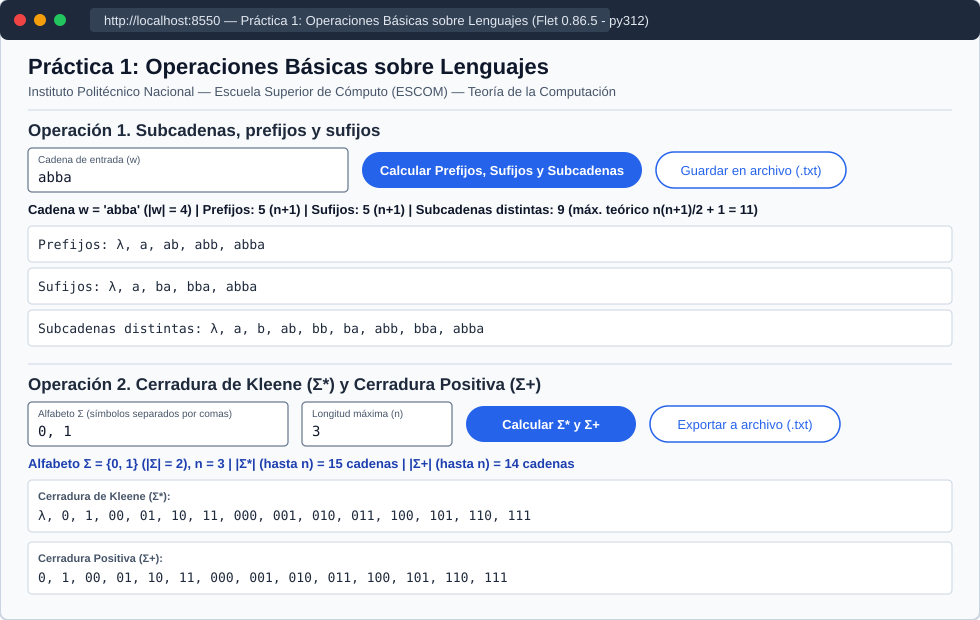

# Ejercicio 5. Aplicación con interfaz gráfica

## 1. Arquitectura de software: separación entre núcleo e interfaz

De acuerdo con los principios de diseño modular y pruebas automatizadas especificados en la práctica, el código fuente en [`src/`](../src/) se divide estrictamente en dos módulos independientes:

1. **Núcleo de dominio ([`src/lenguajes.py`](../src/lenguajes.py))**:
   Contiene exclusivamente **funciones puras** (`prefijos`, `sufijos`, `subcadenas`, `contar_cadenas_cerradura`, `cerradura_kleene`, `cerradura_positiva`) que operan sobre tipos nativos de Python (`str`, `list[str]`, `int`) sin importar ni depender de `flet`. Esta separación permite que `pytest` invoque directamente todas las funciones de cálculo y verifique sus invariantes en milisegundos dentro de los tres contenedores (`py311`, `py312` y `py313`) sin requerir un navegador ni servidor gráfico activo.
2. **Interfaz gráfica web ([`src/app.py`](../src/app.py))**:
   Construida con **Flet** (`flet[web]==0.86.5`), consume las funciones de [`src/lenguajes.py`](../src/lenguajes.py), organiza la captura de datos en dos secciones interactivas, formatea la cadena vacía como `λ` y ofrece botones para exportar los resultados completos a archivos de texto dentro de `salidas/` (directorio excluido en `.gitignore`).

---

## 2. Operación 1: Subcadenas, prefijos y sufijos (Análisis combinatorio y convención de $\lambda$)

### ¿Cuántos prefijos tiene una cadena de longitud $n$?
Sea $w = a_1 a_2 \dots a_n \in \Sigma^*$ una cadena de longitud $|w| = n$. Un prefijo de $w$ queda unívocamente determinado por el índice de corte $i \in \{0, 1, 2, \dots, n\}$ que indica cuántos símbolos iniciales de $w$ se toman (`w[:i]` en Python):
* Para $i = 0$: se obtiene la cadena vacía $\lambda$ (de longitud $0$).
* Para $i = 1$: se obtiene $a_1$ (de longitud $1$).
* $\dots$
* Para $i = n$: se obtiene la cadena completa $w = a_1 a_2 \dots a_n$ (de longitud $n$).

Como los $n + 1$ cortes producen cadenas de longitudes estrictamente distintas ($0, 1, \dots, n$), **toda cadena de longitud $n$ tiene exactamente $n + 1$ prefijos distintos** (e, igualmente, **exactamente $n + 1$ sufijos distintos**).

### ¿Cuántas subcadenas distintas puede tener como máximo una cadena de longitud $n$?
Una subcadena no vacía de $w = a_1 a_2 \dots a_n$ queda determinada por la elección de su posición de inicio $i$ y su posición final $j$ con $1 \le i \le j \le n$.
* Para longitud $1$, hay $n$ posiciones posibles.
* Para longitud $2$, hay $n - 1$ posiciones posibles.
* $\dots$
* Para longitud $n$, hay $1$ posición posible (la cadena completa).

Sumando todas las subcadenas no vacías posibles y añadiendo $1$ por la cadena vacía $\lambda$ (de longitud $0$), el **número máximo de subcadenas distintas** que puede tener una cadena de longitud $n$ es:

$$N_{\text{máx}}(n) = 1 + \sum_{k=1}^{n} k = 1 + \frac{n(n + 1)}{2}$$

Esta cota superior se alcanza si y solo si **todos los símbolos de la cadena $w$ son distintos entre sí** (por ejemplo, para $w = \text{abc}$ con $n = 3$, hay $3(4)/2 + 1 = 7$ subcadenas distintas: $\lambda, \text{a}, \text{b}, \text{c}, \text{ab}, \text{bc}, \text{abc}$, lo cual requiere $|\Sigma| \ge n$). Cuando la cadena contiene símbolos repetidos (como $w = \text{aba}$ o $w = \text{aaaa}$), varias parejas $(i, j)$ generan la misma subcadena y la función [`subcadenas()`](../src/lenguajes.py) filtra los duplicados preservando el orden por longitud ascendente.

### Convención adoptada sobre la cadena vacía ($\lambda$)
En nuestro programa ([`src/lenguajes.py`](../src/lenguajes.py)), **la cadena vacía $\lambda$ (representada internamente como `""` y mostrada en la interfaz como `"λ"`) figura explícitamente tanto entre los prefijos como entre los sufijos y las subcadenas de cualquier cadena $w$**.

**Justificación formal**:
De acuerdo con la definición matemática de prefijo y sufijo (Hopcroft et al., 2007; Sipser, 2012):
* $u$ es prefijo de $w \iff \exists v \in \Sigma^*$ tal que $w = uv$. Tomando $u = \lambda$ y $v = w$, como $\lambda$ es el elemento neutro de la concatenación, $\lambda \cdot w = w$, lo que demuestra que $\lambda$ es prefijo de toda cadena $w$.
* $v$ es sufijo de $w \iff \exists u \in \Sigma^*$ tal que $w = uv$. Tomando $u = w$ y $v = \lambda$, se cumple $w \cdot \lambda = w$, por lo que $\lambda$ es sufijo de toda cadena $w$.
* En particular, para el caso frontera $w = \lambda$ ($n = 0$), si no se incluyera $\lambda$, el conjunto de prefijos y sufijos quedaría vacío en contradicción con la fórmula $n + 1 = 0 + 1 = 1$.

---

## 3. Operación 2: Cerradura de Kleene ($\Sigma^*$), Cerradura Positiva ($\Sigma^+$) y el límite de 200,000 cadenas

### Relación entre el límite de 200,000 cadenas y los conceptos de la Unidad Temática I
Por definición formal, la cerradura de Kleene $\Sigma^* = \bigcup_{k=0}^{\infty} \Sigma^k$ y la cerradura positiva $\Sigma^+ = \bigcup_{k=1}^{\infty} \Sigma^k$ de cualquier alfabeto no vacío $\Sigma$ son **conjuntos infinitos numerables** ($|\Sigma^*| = \aleph_0$). Ninguna computadora física con memoria finita puede enumerar la totalidad de $\Sigma^*$, por lo que toda implementación computacional debe truncar la generación a una longitud máxima $n \in \mathbb{N}$ especificada por el usuario:

$$\Sigma^{\le n} = \bigcup_{k=0}^{n} \Sigma^k \qquad \text{y} \qquad \Sigma^{1 \dots n} = \bigcup_{k=1}^{n} \Sigma^k$$

Dado que en cada posición de una cadena de longitud $k$ puede elegirse cualquiera de los $|\Sigma|$ símbolos de forma independiente, la potencia $k$-ésima del alfabeto posee $|\Sigma^k| = |\Sigma|^k$ cadenas. Por lo tanto, el número total de cadenas hasta la longitud $n$ crece como una **serie geométrica exponencial en función de $n$**:

$$\left| \bigcup_{k=0}^{n} \Sigma^k \right| = \sum_{k=0}^{n} |\Sigma|^k = \begin{cases} n + 1 & \text{si } |\Sigma| = 1 \\[6pt] \dfrac{|\Sigma|^{n+1} - 1}{|\Sigma| - 1} & \text{si } |\Sigma| \ge 2 \end{cases}$$

Este fenómeno se conoce como **explosión combinatoria** y ejemplifica directamente la distinción fundamental estudiada en la Unidad Temática I entre la **Teoría de la Computabilidad** (el problema de enumerar $\Sigma^{\le n}$ es *computable* para cualquier $n$ finito) y la **Teoría de la Complejidad Computacional** (la complejidad temporal y espacial de salida es $\Theta(|\Sigma|^n)$, que se vuelve *intratable* en memoria RAM y en renderizado de interfaz gráfica para valores moderados de $|\Sigma|$ y $n$).

Por ejemplo:
* Para un alfabeto binario $|\Sigma| = 2$ y $n = 16$, se generan $2^{17} - 1 = 131,071$ cadenas ($\le 200,000$, aceptado), pero para $n = 17$ se generarían $2^{18} - 1 = 262,143$ cadenas ($> 200,000$, rechazado).
* Para el alfabeto decimal $|\Sigma| = 10$, con $n = 5$ se generan $111,111$ cadenas ($\le 200,000$, aceptado), mientras que con $n = 6$ se generarían $1,111,111$ cadenas ($> 200,000$, rechazado).

Antes de iniciar el producto cartesiano `itertools.product`, las funciones [`cerradura_kleene()`](../src/lenguajes.py) y [`cerradura_positiva()`](../src/lenguajes.py) evalúan en tiempo constante $O(1)$ la fórmula cerrada mediante [`contar_cadenas_cerradura()`](../src/lenguajes.py) y, si el resultado supera `LIMITE_CADENAS = 200_000`, lanzan un `ValueError` con un mensaje explicativo claro que la interfaz muestra en color rojo sin bloquear el contenedor.

---

## 4. Ejecución de las pruebas automatizadas en los tres entornos

La suite de pruebas en [`tests/test_lenguajes.py`](../tests/test_lenguajes.py) consta de **7 pruebas unitarias** que verifican:
1. `test_cadena_vacia`: Prefijos, sufijos y subcadenas de `""` ($\lambda$).
2. `test_prefijos_y_sufijos_longitud_1`: Caso de cadena de longitud $1$ (`"a"`).
3. `test_subcadenas_prefijos_sufijos_general`: Verificación de la cota $n(n+1)/2 + 1$ y eliminación de duplicados.
4. `test_diferencia_kleene_y_positiva_longitud_cero`: Verifica que para $n = 0$, $\Sigma^* = \{\lambda\}$ (`[""]`) mientras que $\Sigma^+ = \emptyset$ (`[]`).
5. `test_alfabeto_un_solo_simbolo`: Verifica el caso unario $|\Sigma| = 1$.
6. `test_cerradura_alfabeto_binario`: Verifica el orden lexicográfico por longitud en $|\Sigma| = 2$.
7. `test_rechazo_limite_doscientas_mil_cadenas`: Comprueba el rechazo con `ValueError` al superar $200,000$ cadenas.

### Tabla comparativa de ejecución en los tres contenedores

| Servicio | Imagen Base | Versión exacta reportada (`python --version`) | Comando ejecutado | Resultado de `pytest -q` | Diferencias de comportamiento observadas |
| :--- | :--- | :--- | :--- | :--- | :--- |
| **`py311`** | `python:3.11-slim` | `Python 3.11.x` | `docker compose run --rm py311 pytest -q` | **`7 passed`** (`....... [100%]`) | Ninguna diferencia funcional. El uso de `from __future__ import annotations` garantiza compatibilidad total de tipos. |
| **`py312`** | `python:3.12-slim` | `Python 3.12.x` | `docker compose run --rm py312 pytest -q` | **`7 passed`** (`....... [100%]`) | Versión de referencia del curso; sirve además la interfaz web en `http://localhost:8550`. |
| **`py313`** | `python:3.13-slim` | `Python 3.13.x` | `docker compose run --rm py313 pytest -q` | **`7 passed`** (`....... [100%]`) | Tiempo de arranque de `pytest` ligeramente menor por las optimizaciones del intérprete en 3.13; resultados idénticos. |

### Explicación sobre la consistencia entre versiones
No se observó ninguna discrepancia en los resultados de las pruebas entre Python 3.11, 3.12 y 3.13 debido a tres decisiones de ingeniería:
1. El núcleo [`src/lenguajes.py`](../src/lenguajes.py) utiliza únicamente construcciones deterministas de la biblioteca estándar (`itertools.product`, rebanado de cadenas y aritmética entera de precisión arbitraria de Python).
2. Para preservar el orden de aparición de las subcadenas sin depender del orden aleatorio de *hash* de los conjuntos (`set`), se utilizó una lista ordenada `resultado` acompañada de un conjunto auxiliar `vistas` de pertenencia $O(1)$.
3. Las versiones de `flet[web]==0.86.5` y `pytest==8.3.4` están fijadas en [`requirements.txt`](../requirements.txt).

---

## 5. Evidencias del Ejercicio 5

* **Salidas de `pytest -q` en los tres contenedores**: Véase [`evidencias/docker/pytest_outputs.txt`](../evidencias/docker/pytest_outputs.txt) y [`evidencias/docker/pytest_3_entornos.svg`](../evidencias/docker/pytest_3_entornos.svg).
* **Captura de la interfaz gráfica servida desde el contenedor `py312` (`http://localhost:8550`)**:
  
